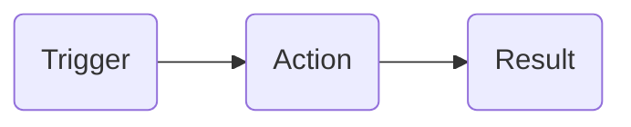
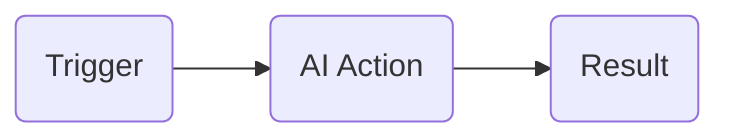

# n8n

**There are a lot of platforms for making automation AI Agents.**
1. n8n
2. make.com

`make.com` is little bit easy. But we will use n8n.

### We will make your first agent.

* n8n is an workflow automation tool. 
* More powerful and more customizable. 
* AI Agents can multiply your productivity. 
* People are maing $5k-15k by selling it. 
* You need very basics knowledge of logic building. 
* No need to be expert programmer. 

## Automation vs Agent

### Automation

* Automation = Fixed logic
* Trigger -> action -> Output

## Diagrams

`Trigger ->  Action -> Result`

**Automation** is fixed that we say it first and this will not be change. Like if I want to go to school, we use same way and same bus daily on fixed time. Not like I’ll use rikshaw or car for next time. I’ve to use bus daily.

**Trigger** connected with action, when press button action will be start. Trigger will be anything like I receive mail, text message. I make automation on the base of trigger action which is mail action. Like I’m on vacation and auto action is that **got mail, action start that I’m on leave and result will be also mail which send to the sender** You can check that trigger start is mail and action start and result is send to the user which send me first.

### Agents

* Agent = adaptable to unique situation
* Trigger -> AI Action -> Dynamic Output

## Diagram

`Trigger ->AI Action -> Result`

**Agents** are adaptable on unique situation. Like we not said that you have to pick the bus. Agent can take action themselves. They can take rikshaw, take bus or book the car. Can go to home instead of school, go to bazar instead of home etc,.
One thing is different in Automation and Agent is AI involved in action.

`Like if we are running a store of sale products watches and garments. Now here automation will not work properly. We’ve to design AI agent that will send info or notification to the related department that someone order something. Watch depart will be informed, garment department will be informed.`

# LangChain
LangChain is a framework for developing applications powered by large language models (LLMs).
[LangChain](https://www.langchain.com/)

## What is LangChain.
1. A developer way to get into AI (Large Language Model).
Like: If I need self interview and this wants from AI, They even don’t know what type of questions asked by me which is  beginner, expert or moderate level. I can do this with `LangChain`.
2. Give context to AI. 
(I’m your fan not means I’m your pedestal fan, it means I like you individually. 
3. Use multi LLM in your Apps.
Like: Get ready made app from ChatGPT, Test cases from Gemini, documentation from LLM, 
If we need multi LLM, this all features are provide us LangChain.

### Problems

Every request -> Question + Docs

High token -> More bill $

### Solution

Take text -> Break into chunks (Summarize each chunk)

Find the most relative chunk to question

Send chunk + question to LLM (ChatGPT etc)

## Embedding

Test -> Embedding Algorithm -> Embedding [0.8, 0.71, 0.3, -0.4, 0.013, 0.0051]  

Between -1 to 1, Each number is a score on relevancy scale.

### Flow
- Take question & convert to embedding
- Find most relevant embedding in DB
- Question to relative chunk -> ChatGPT

`LangChain gives us tool to handle all of this in an easier way with multiple languages such as Python or JavaScript.`
Data store in Vector database. 

### Vector Database:
PG Vector 
Pine Cone
Chroma

 

 
