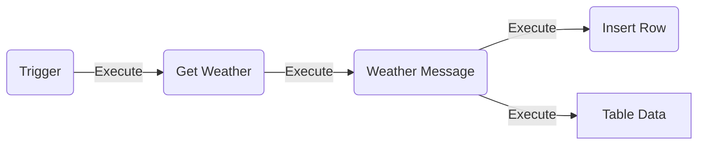
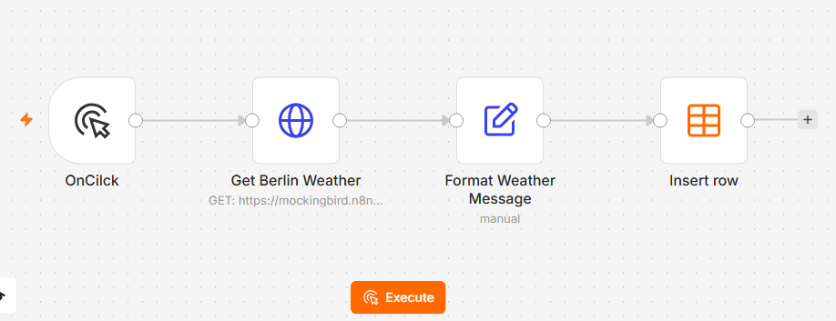
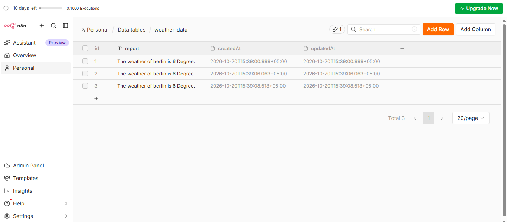
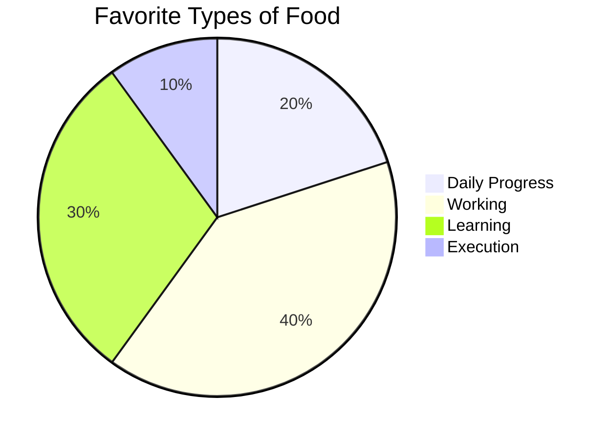

### Data Work Flow Diagram


```
Run Execute
```

# Work Flow Testing 2
# Build Weather Update and store in the Data Table

In this quick start, you’ll build a workflow that fetches the weather for Berlin every morning and turns it into a short report anyone can read at a glance. The workflow saves each report to a data table, so you build up a weather log over time.

## 1. Create the workflow
> Log in to your n8n instance, then:
>> 1.	Select Personal in the left menu. This is where your workflows live.
>> 2.	Select Create workflow at the top right. This opens the canvas, where you’ll build your workflow and spend most of this tutorial.

## 2. Run it on trigger
   
You’ll use: click Trigger

When building a workflow, the first question to answer is: “How should this workflow start?” On a schedule, for example 8 AM every day? When a user submits a form? When an application like Telegram sends a message?

For this first build, you’ll set it to run on click. While you build, you’ll run the workflow yourself to test it. Once you publish it at the end, the schedule runs it for you:

## 3. Trigger manually

>> 1. Select on click trigger. 
>> 2. Get the weather for Berlin.

> You’ll use: HTTP Request

You’ve got your trigger, so it’s time to fetch the weather. The HTTP Request node sends a request to a web address, called an endpoint, and returns the data that address provides. Services that share data this way are APIs.

1.	Select + after the trigger, type http in the Search nodes box, and select HTTP Request.

2.	In the Node details view, paste https://mockingbird.n8n.io/v1/weather/berlin into the URL field.

3.	Select the node’s name at the top left and rename it to Get Berlin Weather, then select Execute step. You should see the weather for Berlin in the output, including the city, temp_c, and condition fields you’ll use in the next step.

```Mockingbird is a sample API with weather for about 40 European cities. Other cities return an error.```

## 4. Turn the weather into a report
   
`You’ll use: Edit Fields (Set)`

Next, you’ll turn the weather data into a short report that anyone can read at a glance.

1.	Select + after Get Berlin Weather, select Data transformation, then select Edit Fields (Set).

2.	Select Add Field in the middle of the Node details view. For Name, enter report.

3.	For Value, enter The temperature in, then drag city from the input panel on the left. When you drop a field in, n8n switches Value to Expression mode, and you see:

```The temperature in {{ $json.city }}```

4.	Drag temp_c in and update the wording to:

```The temperature in {{ $json.city }} is {{ $json.temp_c }}°C.```

## 5.	Rename the node to Format Weather Message and select Execute step. You should see output like:

`The temperature in berlin is 7.4°C. It's currently overcast.`

## 5. Save the data

You’ll use: Data table

You’ve fetched the data and formatted it, so now it’s time to store it. For this, you’ll use n8n’s data tables.

1.	Select Personal in the left menu, then select Data tables.
2.	Select Create data table, name it weather_data, and select Create.
3.	Select Add Column, enter report for Name, then select Add Column again. This gives you a column to store the weather report in.
4.	Open your Weather Log workflow (Personal > Weather Log). Add a Data table node after Format Weather Message and select Insert row as the action.
5.	Rename the node to Save Weather Report.
6.	Select weather_data from the Data table list and change Mapping Column Mode to Map Automatically. The report field from Format Weather Message has the same name as the column in the data table, so n8n maps them for you.


## 6. Test and publish the workflow

Your workflow is complete. Test it, then publish it so it runs every day at 8 AM.

1.	Select Execute workflow to test it, then open the weather_data table to check that n8n inserted a row.
2.	Select Publish in the Canvas header and follow the prompts to publish the workflow.

## What learned

Congratulations, your workflow now runs manually. Along the way, you’ve learned how to:

•	Start a workflow with a trigger. Yours runs on a schedule also possible. **Schedule Trigger**.<br/>
•	Add and connect nodes. Each node does one job and passes its result to the next. **Work with nodes**.<br/>
•	Fetch data from an API. You used the HTTP Request node to get weather data from a web address. **HTTP Request**.<br/>
•	Work with data between nodes. The output of one node becomes the input of the next. **Understand n8n's data structure**.<br/>
•	Use expressions. Dragging fields in builds an expression for you, so you can use live data without writing code. **Expressions for data transformation**.<br/>
•	Store data. Each run saves a new row to your data table, so you keep every report after the workflow finishes. **Data tables**.<br/>









<br/>
