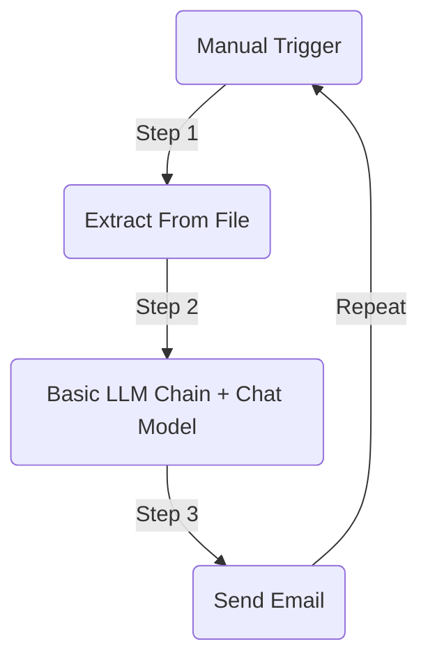
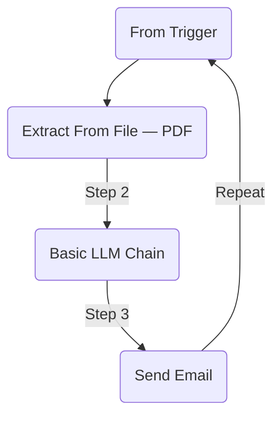
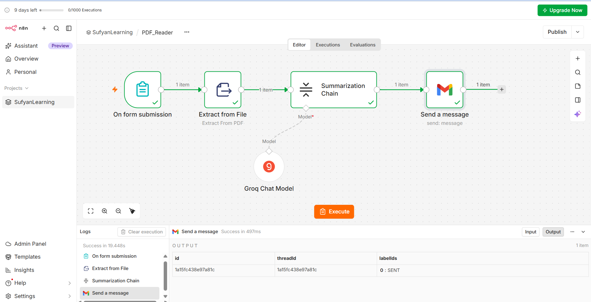

# PDF reader and summarize

**n8n Project 3: AI PDF Reader & Summarizer**

We'll start with the simplest version: `upload a PDF → extract text → summarize with AI → send the summary by email.`

## Step 1 — Understand the workflow

## Flow diagrams


For the first test, we'll use a PDF file that you supply to the workflow. Once it works, we can automate uploading through a webpage, Telegram, or Google Drive.

## Step 2 — Create a new workflow
1.	Open your n8n dashboard. <br/>
2.	Click Create Workflow (or Add workflow, depending on your version).<br/>
3.	Give it this name: AI PDF Reader and Summarizer.<br/>
4.	Click Add first step.<br/>
5.	Search for Manual Trigger and add it.<br/>

The Manual Trigger lets you run the workflow yourself while testing.

## Step 3 — Add a PDF upload form

A small correction to our workflow design: Manual Trigger cannot upload a PDF by itself. To upload a file, we'll use n8n's Form Trigger instead.

1.	Remove the Manual Trigger node, or leave it unused.<br/>
2.	Add a Form Trigger node.<br/>
3.	Set the form title to AI PDF Summarizer.<br/>
4.	Add a form element:
   *	Field Label: Upload PDF
   *	Field Name: pdfFile
   *	Element Type: File
   *	Required Field: Enabled

5.	Save the node.

The exact labels can vary by n8n version. Configure the field to accept PDF files if your version offers file-type restrictions.

When you test the form, n8n will give you a test URL. Open that URL in your browser and upload a small text-based PDF.


## Step 4 — Extract the PDF text

Now connect the Form Trigger to an Extract From File node.

Extract From File

Configure these fields:
  *  Operation: Extract From PDF
  *  Input Binary Field: pdfFile

The input binary field must match the actual binary property produced by your Form Trigger. If your output shows data instead of pdfFile, use data.

Next, click Execute step or submit the form again to test the extraction.

Open the node's output and look for the extracted text in the JSON data. The field may be named text.

If you see readable text from your PDF, this step is working. n8n's Extract From File node converts file content into data that later nodes can process.


## Step 5 — Add the AI summarization node

Now we'll use AI to read the extracted text and produce a useful summary.

1.	Add a Basic LLM Chain node.

2.	Connect Extract From File to Basic LLM Chain.

3.	Open the Basic LLM Chain node.

4.	Set Prompt to Define below.

5.	In the prompt field, switch to Expression mode if needed and enter the following prompt.

`PDF summarization prompt`

```text
You are an expert document summarizer. Analyze the following PDF text and create a clear summary.
Include: 1. Document topic and purpose
2. Main points
3. Important facts, dates, and numbers
4. Key findings
5. Conclusion Use simple English and headings.
Do not invent information.
If the document is incomplete or unclear, mention it.
Document text: {{ $json.text }}
```


Connect the AI model


The Basic LLM Chain needs a language model connected to its model input.

1.	Click the small Add Model connector under the Basic LLM Chain node.


2.	Select OpenAI Chat Model.

3.	Create or select your OpenAI credentials.

4.	Choose a model available to your account.

5.	Save and execute the chain.

If you use OpenAI API credentials, API usage may incur separate charges. Availability of gateway credits depends on your n8n plan.


## Step 6 — Send the summary by email

Add a Send Email node after Basic LLM Chain.

Configure the following:

|Field|	What to enter|
|-----|---------------|
|Credential|	Your SMTP email credentials|
|From Email	Your sending email address|
|To Email|	Your receiving email address|
|Subject|	Your PDF Summary|
|Email Format|	HTML or text|

For the email body, use an expression referencing the summary returned by the AI node. The exact output property depends on your node version, so first execute the Basic LLM Chain and inspect its output.

For example, if the summary appears in a field named `text`, use:

```
{{ $json.text }}
```

If it appears under a different field, use that field instead.

For Gmail SMTP, you may need an app password with two-step verification enabled. Never put your email password or API key directly into the prompt.


Form Trigger

Extract From File — PDF

Basic LLM Chain

↳ OpenAI Chat Model connects to the chain's model input

Send Email

### Your finished workflow should look like this:


## Step 8 — Improve the project after it works

Once the basic workflow succeeds, you can add:

* Data Table: Save the PDF filename, date, and summary.

* Long PDFs: Use chunking or a Summarization Chain to handle documents that exceed the model's context limit.

* Scanned PDFs: Add OCR for documents whose pages are images rather than selectable text.

* Downloadable result: Generate a formatted summary document or PDF.

**Your first target:** get one small PDF successfully summarized and emailed. If you encounter an error, share a screenshot of the node configuration or output, and we can troubleshoot that exact step.


# Final Prompts for Getting related data

## 1. Individual Summary Prompt

```text
You are an expert document summarization assistant.

Your task is to summarize the following section of a PDF document.

**Instructions:**
1. Identify the main ideas and key points.
2. Preserve important facts, dates, names, statistics, and figures.
3. Include important explanations, arguments, and findings.
4. Remove repetition and unnecessary details.
5. Use clear, simple English.
6. Do not invent information or add facts that are not present in the text.
7. Preserve important technical terms and their meanings.
8. If the section contains a decision, recommendation, or action item, include it.
9. Make the summary concise but informative.
10. Remember that this is only one section of a larger document. Do not write an overall conclusion unless this section itself contains one.

**Output format:**

**Section Topic:**  
Briefly identify what this section discusses.

**Key Points:**
- List the most important points.
- Include relevant facts and figures.

**Important Details:**
- Include essential explanations, dates, statistics, or examples.

**Section Summary:**  
Write a concise paragraph summarizing the section.

**PDF Section Text:**

{{ $json.text }}
```

Where to use it: In the prompt field of the AI node that processes each chunk. Replace {{ $json.text }} if your extracted text is stored under a different field.

## 2. Final Prompt to Combine

After summarizing all chunks, pass their individual summaries to another AI node using this prompt. It combines them into one coherent summary of the entire PDF.

```test
You are an expert document synthesis and summarization assistant.

Your task is to combine multiple individual section summaries into one complete, accurate, and well-organized summary of the original PDF document.

**Instructions:**
1. Read all the individual summaries carefully.
2. Identify the document's overall purpose, central theme, and main message.
3. Combine related ideas and remove duplicated information.
4. Preserve important facts, dates, names, statistics, figures, findings, and technical terms.
5. Maintain the original meaning and context of the document.
6. Identify major conclusions, recommendations, decisions, and action items where applicable.
7. Organize the information using clear headings and bullet points.
8. Distinguish established facts from opinions or recommendations stated in the document.
9. Do not invent information or introduce external facts.
10. If the summaries contain conflicting information or leave important gaps, mention the uncertainty rather than guessing.
11. Give greater attention to the most important information, not simply the first or last sections.
12. Avoid unnecessary repetition and overly detailed explanations.

**Required Output Format:**

# Complete PDF Summary

## 1. Document Overview
Explain the document's subject, purpose, and main objective.

## 2. Executive Summary
Provide a concise overview of the entire document.

## 3. Main Topics and Key Points
Organize the most important ideas under suitable headings.

## 4. Important Facts and Figures
List significant names, dates, numbers, statistics, and findings.

## 5. Conclusions and Recommendations
Summarize the document's conclusions and recommendations, if present.

## 6. Action Items
List any required actions, responsibilities, or next steps mentioned in the document. If none are present, state that no specific action items were identified.

## 7. Final Takeaway
Explain the most important message the reader should remember.

**Individual Section Summaries:**

{{ $json.summaries }}
```

Important: `{{ $json.summaries }}` is a placeholder for the combined input. In n8n, you must actually aggregate the outputs from all chunk summaries into one field named summaries, or change the expression to match your data structure.





<br/>
